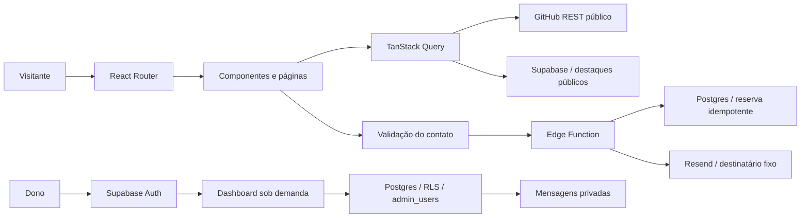

# Arquitetura e decisões

Documentação consultada em 29/10/2026. Objetivo: cumprir o CP3 preservando o portfólio e mantendo escolhas explicáveis na apresentação.

| Escolha                     | Alternativa                        | Critério e concessão                                                                                                                                                    |
| --------------------------- | ---------------------------------- | ----------------------------------------------------------------------------------------------------------------------------------------------------------------------- |
| JavaScript + React/Vite     | TypeScript / Next.js               | Escolha do autor e scaffold existente; SPA suficiente, sem tipagem estática.                                                                                            |
| React Router declarativo    | TanStack Router / roteador próprio | Rotas simples com links diretos; exige rewrite na hospedagem.                                                                                                           |
| TanStack Query              | fetch/cache próprios               | Cache compartilhado, erro/loading; dependência adicional. staleTime 15 min, retenção 1 hora, sem refetch no foco.                                                       |
| Supabase Auth/Postgres/RLS  | Firebase / backend Node            | SQL e proteção dos dados junto ao login; depende de conta/configuração externa.                                                                                         |
| Edge Function + Resend      | mailto / EmailJS isolado           | Envio real com armazenamento e secrets no servidor; banco e provedor não compartilham transação, então usamos UUID idempotente e payload persistido.                    |
| Tailwind 4 + CSS próprio    | CDN / biblioteca visual pronta     | Build local, tokens monocromáticos e identidade preservada; Base UI oferece comportamento acessível sem visual imposto.                                                 |
| Motion + Lenis              | Apenas scroll nativo               | Motion controla paralaxe/progresso; o provider React do Lenis reproduz a rolagem do protótipo. Movimento reduzido usa rolagem imediata. Ver [animações](animations.md). |
| Context/localStorage        | Zustand / Redux                    | Tema e sessão são pequenos; cache remoto já é responsabilidade do Query. Sem storage, tema funciona sem persistir.                                                      |
| Vitest/Testing Library/Node | Jest / só manual                   | Integração Vite e testes de comportamento sem secrets; RLS ainda precisa de teste SQL.                                                                                  |
| Oxlint/Prettier/Husky       | ESLint / Biome                     | Preserva linter do scaffold e automatiza estilo e commits.                                                                                                              |

O plugin Babel mais novo consultado não satisfazia o peer dependency do plugin React 6.1.2. Mantido `@rolldown/plugin-babel@0.2.4`, compatível, sem forçar resolução. Dependências foram consultadas/instaladas com `@latest`; as versões exatas estão no lockfile.

Login identifica o usuário; `admin_users` autoriza o administrador. A proteção React evita mostrar a área indevida; RLS protege os dados mesmo se a interface for ignorada. Apenas o servidor executa RPCs de contato. `user_metadata` não concede privilégios.

Fontes oficiais: [React Router](https://reactrouter.com/start/declarative/installation), [TanStack Query](https://tanstack.com/query/latest/docs/framework/react/guides/important-defaults), [Tailwind/Vite](https://tailwindcss.com/docs/installation/using-vite), [Base UI](https://base-ui.com/react/components/dialog), [Motion](https://motion.dev/docs/react-scroll-animations), [GitHub REST](https://docs.github.com/en/rest/repos/repos), [Supabase RLS](https://supabase.com/docs/guides/database/postgres/row-level-security), [Vite deploy](https://vite.dev/guide/static-deploy).
